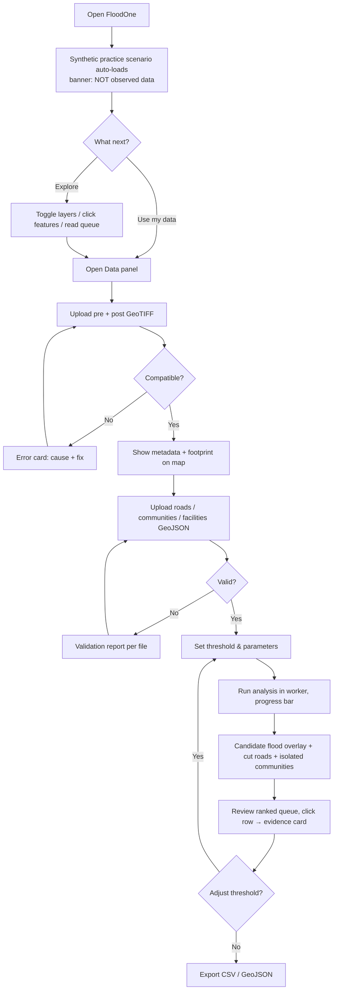

# FloodOne — UI/UX Flow

Design direction taken from `plan.md`: **Cartographic mission-control** — map first, evidence always visible, priorities explainable, calm under time pressure.

---

## 1. Design System

### 1.1 Colour tokens (define in `client/src/index.css`)
| Token | Value (suggested) | Use |
|---|---|---|
| `--bg` | `#0F1A24` deep slate | App background (dark) |
| `--surface` | `#16242F` | Panels |
| `--surface-2` | `#1D2F3D` | Raised cards |
| `--paper` | `#F5F1EA` warm off-white | Text on dark / light theme bg |
| `--signal` | `#22D3EE` glacier cyan | Flood signal, primary accent, focus ring |
| `--caution` | `#F5A524` amber | Warnings, uncertain data |
| `--urgent` | `#E5484D` vermilion | Isolated / urgent only |
| `--ok` | `#3FB68B` | Reachable / success |
| `--muted` | `#8DA2B3` | Secondary text (check ≥ 4.5:1) |

Never rely on colour alone: pair with icons/labels (e.g. ⚠ + "Isolated").

### 1.2 Typography
- **Space Grotesk** — headings, section labels
- **Inter** — UI text
- **IBM Plex Mono** — coordinates, timestamps, provenance, numeric columns
- Fallbacks: `system-ui, sans-serif` / `ui-monospace, monospace`

### 1.3 Components (reuse existing shadcn kit)
`Button`, `Card`, `Tabs`, `Slider`, `Switch`, `Badge`, `Sheet`/`Drawer` (mobile), `Dialog`, `Tooltip`, `Table`, `Alert`, `Progress`, `Skeleton`, `sonner` toasts, `ScrollArea`, `Resizable` panels.

### 1.4 Custom components
`ProvenanceChip` (Synthetic · Imported · Computed), `CaveatBanner`, `ThresholdControl`, `ImportDropzone`, `QueueRow`, `EvidenceCard`, `Legend`, `FloodOneLogo` (F-shaped river channel with bridge crossing, SVG).

### 1.5 Motion
Panel transitions 150–200 ms; selected marker gentle pulse; **all disabled under `prefers-reduced-motion`**.

### 1.6 Voice
Plain, concise, operational. Examples: *"See the flood signal. Find who is cut off."* · *"Candidate change detected — verify before deployment."* · *"Pre and post images cover different areas. Re-export both with the same extent."*

---

## 2. Information Architecture

```
/                  Operations dashboard (single main page)
 ├─ Left rail      Nav: Scenario · Data · Analysis · Export · Help
 ├─ Center         Map (primary)
 ├─ Right panel    Ranked response queue + evidence
 └─ Bottom/Drawer  Import log · Warnings · Method & caveats
/about              Method, data sources, limitations (optional)
/404                NotFound (exists)
```
Phase 2 adds: `/login`, `/incidents`, `/incidents/:id`, `/admin`.

---

## 3. Master User Flow



---

## 4. Screen Specifications

### 4.1 Dashboard — desktop (≥ 1024 px)

```
┌────┬──────────────────────────────────────────────┬──────────────────────┐
│Logo│ [SYNTHETIC PRACTICE SCENARIO — not observed data]  [Export ▾] [Help] │
├────┼──────────────────────────────────────────────┬──────────────────────┤
│ Nav│                                              │ Response queue       │
│    │                                              │ ───────────────────  │
│ ◉ S│            M A P                             │ 1 ⚠ Kasa     4,200   │
│ ⬆ D│   (flood overlay · roads · communities)      │ 2 ⚠ Rampur   2,900   │
│ ⚙ A│                                              │ 3   Nandgaon 1,100   │
│ ⤓ E│  ┌ Layers ┐                       ┌Legend┐   │ …                    │
│ ? H│  │☑ Flood │                       └──────┘   │ ───────────────────  │
│    │  │☑ Roads │                                  │ Evidence card        │
│    │  │☑ Cut   │                                  │ Why ranked #1: …     │
│    │  └────────┘                                  │ Source · Confidence  │
├────┴──────────────────────────────────────────────┴──────────────────────┤
│ Threshold ──●─────  −3.0 dB   │ Flooded 8.4 %  Cut roads 14  Isolated 5   │
└──────────────────────────────────────────────────────────────────────────┘
```

### 4.2 Dashboard — mobile (< 768 px)
- Map full-width, 60 vh; metrics strip beneath.
- Queue becomes a **bottom sheet** (peek: top 3, drag up for all).
- Layer & data controls in a `Drawer` opened from a floating button.
- Tap queue row → map flies to community and opens evidence card.
- Touch targets ≥ 44 px.

### 4.3 Data panel
| Section | Contents |
|---|---|
| Imagery | Two dropzones (Pre / Post). After load: filename, size, CRS, pixel size, bbox, band count, nodata, ProvenanceChip = *Imported* |
| Vectors | Roads · Communities · Facilities · (optional) Population raster — each with count, validation status ✔ / ⚠ / ✖ |
| Issues | Expandable list: severity icon, plain-language message, **how to fix** |
| Actions | `Load synthetic scenario` · `Clear all data` (with confirm) |

### 4.4 Analysis controls
- Band select (VV / VH), **threshold slider** with numeric input and "what this means" tooltip.
- Advanced (collapsed): min road overlap %, snap tolerance, ranking weights, speckle filter toggle.
- Debounced live re-run; subtle "Updating…" chip (no layout shift).

### 4.5 Evidence card (selected community)
- Name, population (with source/vintage if supplied), urgency.
- **Status badge**: Isolated / Reachable (longer route) / Unaffected / No road access in data.
- "Why this rank" bullets (from `reasons[]`).
- Mini-map inset showing blocked routes in vermilion.
- Copy coordinates (mono) · "Verify before deployment" note.

### 4.6 Export menu
`Download queue (CSV)` · `Download results (GeoJSON)` · filenames include date + scenario label; toast confirms count of rows.

---

## 5. States & Edge Cases

| State | UI behaviour |
|---|---|
| First load | Skeleton → synthetic scenario; banner visible |
| No data uploaded | Empty-state with two clear actions: *Use practice scenario* / *Upload data* |
| Parsing in progress | Progress bar with stage name ("Reading GeoTIFF… 40 %") |
| Raster too large | Info alert: "Downsampled 4× to fit browser memory (limit 25 M px)" |
| CRS/grid mismatch | **Blocking** error card, shows both values side-by-side + fix |
| Invalid GeoJSON | Report lists first 10 issues + "N more"; valid features still previewable but analysis disabled until resolved |
| No facilities | Warning; isolation step skipped; explains why |
| Zero flooded pixels | Result shown ("No candidate change at this threshold") + suggestion to lower threshold |
| Everything flooded (> 60 %) | Caution: "Unusually high — check dB conversion or image pair" |
| Worker crash | Toast + retry; app remains usable |
| Offline tiles | Basemap greyed; overlays still render; notice shown |
| Unhandled exception | `ErrorBoundary` fallback with reload |

---

## 6. Accessibility Checklist
- [ ] Contrast ≥ 4.5:1 for text, ≥ 3:1 for UI/graphics
- [ ] Visible focus ring (`--signal`) on every interactive element
- [ ] Queue is a real list/table with arrow-key navigation; map selection mirrors it
- [ ] Layer toggles are labelled switches
- [ ] Status never conveyed by colour only
- [ ] `aria-live="polite"` for analysis completion and errors
- [ ] Skip-to-queue and skip-to-map links
- [ ] Reduced-motion variant
- [ ] Map has a non-visual alternative: the queue table + CSV export

---

## 7. Copy Rules (trust & safety)
1. Never write "flooded areas" for computed output; write **"candidate flood signal"**.
2. Every computed view carries: *"Exploratory screening signal. Verify with ground reports before deployment."*
3. Synthetic data always shows the amber **SYNTHETIC** chip next to the layer name and in exports.
4. Population is "estimate (source, year)" — never "people affected".

---

## 8. Phase-2 Screens (outline)
| Screen | Purpose |
|---|---|
| Login | "Continue with Manus" single button (see `04_AUTH_FLOW.md`) |
| Incident list | Cards with status, last run, members |
| Incident workspace | Same dashboard + saved datasets and run history |
| Run compare | Side-by-side runs at different thresholds |
| Admin | Members, roles, audit log |

---

## 9. Usability Test Script (30 min)
1. Open app cold; say what you think it shows. *(Is the synthetic label noticed?)*
2. Find the most urgent community and explain why it ranks first.
3. Change the threshold; describe what changed.
4. Upload a deliberately mismatched raster pair; recover from the error.
5. Export the queue and open it in a spreadsheet.

**Pass criteria:** ≥ 4/5 testers complete steps 1–5 unaided; 0 testers describe synthetic data as real.
