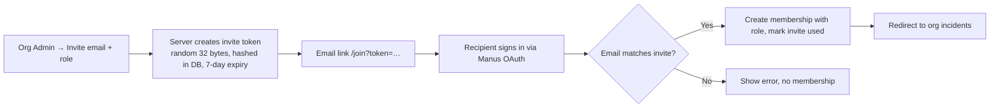

# FloodOne — Authentication & Authorization Flow

## 1. Principle: Auth is phased

| Phase | Auth | Why |
|---|---|---|
| **MVP (v1.0)** | **None.** No login, no server uploads. Everything runs locally in the browser | `plan.md`: "no account, remote upload, incident database" — and the best privacy is never receiving the data |
| **Pilot (v2.0)** | **Manus OAuth + session cookie + role-based access (RBAC) per organization** | Teams, saved incidents, audit trail |

The starter already contains a working Manus OAuth implementation. This document describes it **as it exists in your code**, then the hardening and RBAC to add.

---

## 2. Existing Login Flow (from your code)

```mermaid
sequenceDiagram
  autonumber
  participant U as User Browser
  participant C as Client (const.ts startLogin)
  participant P as Manus OAuth Portal
  participant S as Express /api/oauth/callback
  participant O as Manus OAuth API (sdk.ts)
  participant D as MySQL users

  U->>C: Click "Sign in"
  C->>C: nonce = crypto.randomUUID()
  C->>U: Set cookie __Host-oauth_state=nonce (10 min, Secure, SameSite=None)
  C->>P: Redirect /app-auth?appId&redirectUri&state(base64{redirectUri,nonce})&responseType=code
  P->>U: User authenticates (email/Google/Apple/Microsoft/GitHub)
  P->>S: 302 /api/oauth/callback?code&state
  S->>S: decodeOAuthState(state) → nonce
  S->>S: nonce must equal __Host-oauth_state cookie, else 403
  S->>U: clear oauth_state cookie
  S->>O: exchangeCodeForToken(code, state)
  O-->>S: accessToken
  S->>O: getUserInfo(accessToken)
  O-->>S: openId, name, email, loginMethod
  S->>D: upsertUser(openId, name, email, loginMethod, lastSignedIn)
  S->>S: createSessionToken(openId) — HS256 JWT {openId, appId, name}
  S->>U: Set-Cookie webdev_app_session=JWT; HttpOnly; Secure; SameSite=None
  S->>U: 302 /
```

### 2.1 Per-request authentication (`createContext` → `sdk.authenticateRequest`)
1. Read cookie `webdev_app_session`.
2. Fallback: `Authorization: Bearer <jwt>` (used for Safari ITP / WebView preview).
3. `jwtVerify` (HS256, secret `MANUS_JWT_SECRET`), check `appId === MANUS_PROJECT_ID`.
4. Load user by `openId`; if missing, sync from OAuth server.
5. Update `lastSignedIn`; attach `ctx.user`.
6. Public procedures tolerate `user = null`; `protectedProcedure` throws `UNAUTHORIZED`; `adminProcedure` throws `FORBIDDEN`.

### 2.2 Client behaviour
- `useAuth()` calls `trpc.auth.me`; `redirectOnUnauthenticated` triggers `startLogin()`.
- Global tRPC error handler in `main.tsx` calls `startLogin()` when it sees `UNAUTHED_ERR_MSG` ("Please login (10001)").
- `logout` clears cookie server-side and `sessionStorage["manus-cookie"]`.

---

## 3. Logout Flow
```
Click "Sign out" → trpc.auth.logout → server clearCookie(webdev_app_session, maxAge -1)
→ client sets auth.me = null, invalidates queries, clears sessionStorage token
→ route to "/" (public, synthetic scenario still works)
```
Also add (v2): server-side session revocation list so a stolen JWT can be killed before expiry (see §6).

---

## 4. Roles & Permissions (Pilot)

The starter only has global `role: user | admin`. FloodOne needs **per-organization roles**.

| Role | View incident | Run analysis | Upload/delete data | Export | Manage members | See audit |
|---|:-:|:-:|:-:|:-:|:-:|:-:|
| **Viewer** | ✔ | – | – | ✔ (CSV) | – | – |
| **Analyst** | ✔ | ✔ | ✔ | ✔ | – | – |
| **Coordinator** | ✔ | ✔ | ✔ | ✔ | invite viewers | – |
| **Org Admin** | ✔ | ✔ | ✔ | ✔ | ✔ | ✔ |
| **Platform Admin** (`users.role='admin'`) | all orgs (support only) | – | – | – | ✔ | ✔ |

### 4.1 Enforcement pattern (tRPC middleware)
```ts
// server/_core/trpc.ts  (add)
export const orgProcedure = (min: OrgRole) =>
  protectedProcedure
    .input(z.object({ orgId: z.number() }).passthrough())
    .use(async ({ ctx, input, next }) => {
      const m = await db.getMembership(ctx.user.id, input.orgId);
      if (!m || rank(m.role) < rank(min))
        throw new TRPCError({ code: "FORBIDDEN", message: "Not allowed in this organization" });
      return next({ ctx: { ...ctx, membership: m } });
    });
```
**Rule — no IDOR:** every query that takes an `incidentId` / `datasetId` must join through `orgId` and verify membership. Never trust an ID alone.

### 4.2 Admin bootstrap
`OWNER_OPEN_ID` env → that user is auto-promoted to `admin` on first upsert (already in `db.upsertUser`). Keep this var secret and set it only in server env.

---

## 5. Invite / Onboarding Flow (Pilot)


---

## 6. Hardening Changes to Make Before Pilot

| # | Current behaviour (in code) | Risk | Change |
|---|---|---|---|
| 1 | Session cookie lifetime **1 year** (`ONE_YEAR_MS`) | Long-lived stolen cookie | Access JWT **8 h**, sliding renewal on activity, absolute max 7 days |
| 2 | Cookie `SameSite=None; Secure` (needed for preview iframe) | Cross-site request exposure | In **production** (not embedded) use `SameSite=Lax`; keep `None` only for preview env via env flag |
| 3 | JWT is the only session state; no revocation | Can't kill a stolen token | Add `sessions(jti, userId, expiresAt, revokedAt)`; check `jti` on each request or keep short-TTL + denylist |
| 4 | `Authorization: Bearer` fallback accepted everywhere | Token in `sessionStorage` is XSS-readable | Disable fallback in production; allow only when `PREVIEW_MODE=true` |
| 5 | `useAuth` writes full user object to `localStorage["manus-runtime-user-info"]` | PII at rest in browser, XSS-readable | Remove; keep user in memory (React Query cache) only |
| 6 | OAuth state is base64 JSON, nonce cookie checked (good) | — | Keep. Add **allow-list** for `redirectUri` host on the server so state can't point elsewhere |
| 7 | No rate limit on `/api/oauth/callback` or `auth.me` | Brute force / DoS | `express-rate-limit`: 20/min/IP on auth routes |
| 8 | `console.warn("[Auth] Missing session cookie")` on every anonymous hit | Log noise hides real events | Log at debug level; log **failed verifications** with IP for alerting |
| 9 | `role` changed only by DB | — | Add admin UI + audit entry for every role change |
| 10 | Cron sessions use `cron_` openId prefix | Privilege confusion | Restrict `/api/scheduled/*` to cron identity only; never expose cron-created tokens to client |

---

## 7. Session Lifecycle (target)

```
Login ─► issue JWT (8h, jti) + sessions row
   │
   ├─ each request: verify signature → check jti not revoked → load membership
   ├─ activity within last 30 min & token > 50 % aged → rotate cookie
   ├─ idle > 30 min → still valid until exp, but sensitive actions (delete dataset,
   │    change role, bulk export) require re-auth within last 15 min
   └─ logout / role change / admin "revoke all" → revokedAt = now()
```

## 8. Auth Test Matrix

| Test | Expected |
|---|---|
| Anonymous opens `/` | Synthetic scenario works |
| Anonymous calls `incident.list` | `UNAUTHORIZED`, client redirects to login |
| Callback with missing nonce cookie | 403 `invalid oauth state` |
| Callback with tampered `state` | 403 |
| Expired JWT | Treated as logged out |
| JWT with wrong `appId` | Rejected |
| Viewer calls `analysis.start` | `FORBIDDEN` |
| User A requests user B's `incidentId` | `FORBIDDEN` (not 404-leak) |
| Role downgraded | Takes effect on next request |
| Logout then reuse old cookie | Rejected (jti revoked) |
| 30 rapid failed callbacks from one IP | Rate-limited (429) |

## 9. What Not To Build
- No custom password storage — identity stays with the OAuth provider.
- No API keys in the browser except the public `apiBrowserKey` already whitelisted in `publicConfig.ts`.
- No "login required" on the MVP page — the offline/synthetic path must always stay open.
