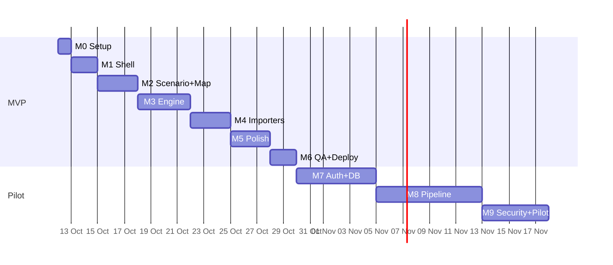

# FloodOne — Implementation Plan

Goal: take the starter in `floodone.zip` to a **working, demo-ready MVP**, then to a secure pilot.
Companion docs: `01_PRD` · `02_TRD` · `03_UIUX_FLOW` · `04_AUTH_FLOW` · `05_SECURITY_PLAN`.

Estimates assume 1–2 developers. Adjust ×1.5 for a solo beginner.

---

## 0. Definition of "Working"
The MVP is done when a new user can, **without any account**:
1. open the app and see the synthetic scenario with its label,
2. toggle layers, click a community, read why it ranks where it does,
3. upload a valid pre/post GeoTIFF pair + roads/communities/facilities GeoJSON,
4. move the threshold slider and watch results update,
5. download CSV and GeoJSON that open in Excel and QGIS,
6. hit every error path (bad CRS, bad GeoJSON, too-large raster) and get a clear message.

---

## 1. Milestone Overview

| M | Name | Duration | Output |
|---|---|---|---|
| M0 | Setup & cleanup | 0.5 d | Clean repo, green baseline |
| M1 | App shell & brand | 1.5 d | Layout, tokens, logo, routes |
| M2 | Synthetic scenario + map | 2.5 d | Working demo with layers, queue |
| M3 | Analysis engine (pure TS) | 4 d | Raster change, road impact, isolation, ranking + unit tests |
| M4 | Importers + worker | 3 d | Real files in, validated, non-blocking |
| M5 | Exports, errors, a11y, mobile | 2.5 d | Polished MVP |
| M6 | QA, hardening, deploy | 2 d | **v1.0 live** |
| — | **MVP total** | **≈ 16 working days** | |
| M7 | Auth + orgs + persistence | 6 d | Pilot backend |
| M8 | Background processing + ingestion | 8 d | Sentinel-1 pipeline (provider-dependent) |
| M9 | Security review + pilot | 5 d | Pen-test fixes, go-live |


*(Dates are placeholders — shift to your start date.)*

---

## 2. Milestone Detail

### M0 — Setup & cleanup (0.5 d)
| Task | Command / action | Done when |
|---|---|---|
| Unzip, install | `unzip floodone.zip && cd floodone && corepack enable && pnpm install` | install succeeds |
| Baseline checks | `pnpm check && pnpm test` | both green |
| Run client only | `pnpm dev:static` (port 3000) | starter page loads |
| Delete junk | remove `vite.config.ts.bak`; leave `ComponentShowcase` unrouted | clean tree |
| Git | `git init`, first commit, `.env` in `.gitignore` | ✔ |
| Add deps | `pnpm add maplibre-gl geotiff proj4 rbush papaparse @turf/helpers @turf/length @turf/bbox @turf/boolean-point-in-polygon @turf/nearest-point-on-line` + `pnpm add -D @types/papaparse @types/rbush` | builds |
| Create route manifest | `public/manus-routes.json` → `["/"]` (referenced by plan.md; missing in zip) — only needed if you deploy on the Manus platform | ✔ |

### M1 — App shell & brand (1.5 d)
- `index.css`: colour tokens, fonts (Space Grotesk / Inter / IBM Plex Mono), focus ring, reduced-motion rule, dark default theme (`ThemeProvider defaultTheme="dark"`).
- `FloodOneLogo.tsx` SVG.
- `Home.tsx` layout: left rail · map region · right queue · bottom metrics bar. Use `ResizablePanelGroup` for desktop, `Drawer` for mobile.
- `index.html`: title "FloodOne — Flood Response Intelligence", meta description, theme-color.
- **Accept:** layout renders on 375 px, 768 px, 1440 px with placeholders; Lighthouse a11y ≥ 90.

### M2 — Synthetic scenario + map (2.5 d)
1. `features/flood/types.ts` (from TRD §4.1).
2. `sampleScenario.ts`: seeded generator → roads, communities, facilities, river mask (`provenance:"synthetic"`).
3. `components/map/FloodMap.tsx`: MapLibre with OSM raster style + attribution; add GeoJSON sources/layers; canvas/image source for flood mask.
4. `LayerPanel`, `Legend`, `ProvenanceChip`, `CaveatBanner`.
5. `QueueList` + `ImpactDetail` wired to **precomputed placeholder impacts** (real engine comes in M3).
6. Selection sync: map click ↔ queue row.
- **Accept:** demo flow A1–A3 in the PRD passes manually; no console errors.

### M3 — Analysis engine (4 d) — *the core*
Build and test **in isolation** before any UI wiring.

| Day | Module | Tests (Vitest) |
|---|---|---|
| 1 | `rasterChange.ts` | 4×4 arrays: threshold boundary, nodata skipped, dB conversion, speckle filter off/on, fraction correct |
| 2 | `roadImpact.ts` | Line crossing a 3-pixel mask → overlap value; below/above `minOverlapFraction`; rbush lookup equals brute force |
| 3 | `isolation.ts` | 6-node graph: cut one edge → predicted isolated set; unreachable facility; snapping failures flagged |
| 4 | `ranking.ts` + integration | Synthetic scenario end-to-end gives expected ranked IDs (snapshot); weights change order predictably |

- Keep every function **pure** (no DOM, no React, no `window`).
- Replace the M2 placeholders with live engine output.
- **Accept:** `pnpm test` green; scenario output deterministic across runs.

### M4 — Importers + worker (3 d)
| Day | Work |
|---|---|
| 1 | `importers.ts` GeoJSON path: schema (`zod`), issue list, coercion, caps. Fixtures: valid, wrong geometry, NaN coords, empty, huge |
| 2 | GeoTIFF path: metadata extraction, CRS handling via `proj4`, pre/post compatibility check, size guard + downsample |
| 3 | `analysis.worker.ts`: message protocol, progress, cancel, transferable buffers; `ImportPanel` UI with dropzones, status icons, issue list; threshold debounce re-runs from cached rasters |
- **Accept:** PRD Epics B, C pass; UI stays responsive (no long task > 50 ms in DevTools) on a 4 M px pair.

### M5 — Exports, errors, a11y, mobile (2.5 d)
- `exports.ts`: CSV (with formula-injection guard) + GeoJSON with `metadata`; filenames include date & `SYNTHETIC` when relevant.
- All error/empty/warning states from UX §5.
- Keyboard navigation, `aria-live`, skip links, contrast audit with axe.
- Mobile bottom-sheet queue, 44 px targets, test on a real phone.
- `ErrorBoundary` fallback copy.
- **Accept:** UX §6 accessibility checklist fully ticked.

### M6 — QA, hardening, deploy (2 d)
| Task | Detail |
|---|---|
| E2E | Playwright: load, toggle, slider, import fixture, export download |
| Security gate (MVP subset) | CSP via static host headers, no `innerHTML`, CSV injection test, remove debug collector from prod build, `pnpm audit` |
| Performance | Lazy-load MapLibre; verify bundle budget (TRD §7) |
| Build | `pnpm check && pnpm test && pnpm build:static` |
| Deploy | Static host (Vercel/Netlify/Cloudflare Pages): publish `dist/public`; add headers file |
| Docs | Update `README.md` with: what it is, how to run, sample data, limitations |
| **Release** | Tag `v1.0.0` |

---

## 3. Pilot Track (after MVP)

### M7 — Auth, orgs, persistence (6 d)
1. Enable full stack: `pnpm dev` with `DATABASE_URL`, `MANUS_*` env.
2. Schema additions (TRD §6) → `pnpm db:push`.
3. `orgProcedure` RBAC middleware (Auth §4.1); invite flow (Auth §5).
4. Routers: `incident`, `dataset`, `analysis`, `export`.
5. Presigned upload from browser → S3 with org-prefixed keys; fix `/manus-storage` auth (Security F1).
6. Apply auth hardening (Auth §6 items 1–8) and Security F2–F6.
7. UI: `/login`, `/incidents`, `/incidents/:id`.
- **Accept:** Auth test matrix (Auth §8) fully green.

### M8 — Background processing & ingestion (8 d)
- Choose provider (open decision): Copernicus Data Space / GEE / Planetary Computer.
- Move engine into a server worker (same pure modules) with queue, memory cap, timeout.
- Scheduled `/api/scheduled/sentinel-poll` via heartbeat.
- Add permanent-water mask and optional terrain filter (UN-SPIDER-style refinements).
- Validation harness against Sen1Floods11 chips (report precision/recall; **publish the numbers in-app**).
- **Accept:** a run on a real recent scene completes unattended and matches the browser result within tolerance on the same inputs.

### M9 — Security review & pilot (5 d)
- Run Security Plan §7 activities; complete §8 release gate.
- External review of RBAC and storage.
- Privacy notice, retention job, backup/restore drill.
- Pilot with one agency/NGO; collect feedback on ranking explanations.

---

## 4. Work Breakdown — Folder Checklist

```
[x] client/src/index.css                       tokens, fonts
[x] client/src/components/brand/FloodOneLogo.tsx
[x] client/src/pages/Home.tsx
[x] client/src/components/map/{FloodMap,layers,Legend}.tsx
[x] client/src/components/flood/{LayerPanel,ThresholdControl,ImportPanel,QueueList,ImpactDetail,ProvenanceChip,CaveatBanner}.tsx
[x] client/src/features/flood/{types,constants,validation,sampleScenario}.ts
[x] client/src/features/flood/{importers,rasterChange,roadImpact,isolation,ranking,exports}.ts
[x] client/src/features/flood/{analysis.worker,store}.ts
[x] client/src/features/flood/__tests__/*.test.ts       (pure engine, exports, security, e2e flow tests)
[x] public/manus-routes.json
[x] README.md update
[x] e2e flow integration suite verified
```
Vitest config check: `vitest.config.ts` currently targets server tests — add `client/src/**/*.test.ts` to `include` so engine tests run.

---

## 5. Default Parameters (document in UI + README)

| Parameter | Default | Note |
|---|---|---|
| Band | VV | VH selectable |
| Change threshold | −3.0 dB (post − pre) | Tunable −1…−10 |
| Water ceiling (post) | −15 dB | Reduces false positives; advanced setting |
| Min road overlap | 30 % of length | Advanced |
| Snap tolerance | 50 m | Advanced |
| Weights (pop/urgency/distance) | 0.5 / 0.3 / 0.2 | Advanced |
| Isolation bonus | +1.0 | Isolated always outrank reachable |
| Raster cap | 25 M px | Downsample above |

These are starting points to be **calibrated on real data**, not validated constants.

---

## 6. Risk Register (delivery)

| Risk | Likelihood | Mitigation |
|---|---|---|
| GeoTIFF edge cases (compression, odd CRS) | High | Fixture corpus early; fail clearly; document supported profiles (WGS84/UTM, uint/float, deflate/LZW) |
| Road graph quality (disconnected OSM data) | High | Show "no road access in data" separately from "cut by flood" |
| Browser memory | Med | Caps, downsampling, worker, progress |
| Map library learning curve | Med | Prototype layers in M2 before anything else |
| Scope creep to "live satellite" | Med | PRD non-goals; roadmap only |
| Solo-developer timeline slip | Med | Cut order: population raster → advanced params → mobile polish (never cut caveats/validation) |

## 7. Testing & Quality Gates per Milestone

| Gate | Command |
|---|---|
| Types | `pnpm check` |
| Unit/integration | `pnpm test` |
| Build | `pnpm build:static` |
| E2E (M6+) | `pnpm exec playwright test` |
| A11y (M5+) | axe in Playwright |
| Bundle | `pnpm exec vite-bundle-visualizer` (or `vite build --report`) |

No milestone is "done" until its acceptance bullet and all gates above pass.

## 8. Demo Script (3 minutes, for judges)
1. **0:00** Open app → point to the SYNTHETIC banner ("we never fake data").
2. **0:20** Toggle flood and roads; show cut roads in vermilion.
3. **0:50** Click #1 queue item → "why ranked first".
4. **1:30** Drag the threshold; queue re-ranks live.
5. **2:00** Upload a real pre/post pair → metadata and footprint.
6. **2:30** Export CSV → open in a spreadsheet.
7. **2:50** Close on roadmap: validated model, Copernicus ingestion, team access.

## 9. First-Week Starter Checklist (copy this)
- [x] Day 1: M0 + M1 shell
- [x] Day 2–3: M2 scenario + map
- [x] Day 4–7: M3 engine with tests
- [x] End of week: demo to one person; note what they misread

## 10. What To Say About Scope (keep honest)
FloodOne v1.0 is a **hackathon-grade, explainable screening tool**. It is **not** an operational emergency-management service until M8 validation and M9 review are complete, and every screen must keep saying so.
